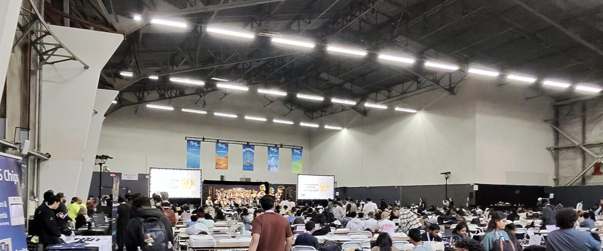

# Upside-Down 2.0: AI Hackathon Mission Control
### Autonomous Multi-Agent Orchestration from Problem Statement to Deployable Release



[](docs/TEST_REPORT.md)
[](contracts/hackathon.ts)
[](web/)
[](server/)

---

## The Problem
Most hackathon teams struggle not because they lack AI coding assistants, but because their assistants operate uncoordinated:
- **Merge Conflicts:** Multiple agents simultaneously editing the same files and breaking build pipelines.
- **Lost Context & Hallucinated APIs:** Frontend developers prompt their agents with imagined API structures while backend developers build something incompatible.
- **Scope Creep & Deadlines:** Teams spend 8 hours debating unfeasible ideas, miss their submission window, and fail to reach live deployment.

## The Solution: Upside-Down 2.0
**Upside-Down 2.0** is an autonomous, web-first mission control platform that guides a 2–3 developer hackathon team through a disciplined, 7-stage software development lifecycle:

1. **AI Idea Studio:** Generates 3–5 distinct project concepts tailored to the problem statement, hackathon rules, and time constraints. Refines concepts conversationally and locks human host approval.
2. **AI Architecture Blueprint:** Synthesizes system specifications, formal API contracts, and a 7-phase timeline with estimated hours before a single line of code is written.
3. **Multi-Agent Work Division (`UD-IC/2.0`):** Partitions work into strictly bounded **Task Contracts 2.0** with file path whitelists (`allowedPaths`) and blacklists (`protectedPaths`).
4. **Agent Prompt Bridges:** Dynamically converts contracts into optimized prompt assignments for **Google Antigravity**, **Anthropic Claude Code**, **OpenAI Codex**, **Cursor**, and **Aider**.
5. **Cross-Agent Handoffs:** Facilitates structured dependency requests when an agent needs an API or schema from a teammate without manual communication overhead.
6. **Collision & Integration Engine:** Automatically detects overlapping file paths across PRs, checks contract conformance, and audits test suites.
7. **Host Release Gatekeeper & Deployment:** Prevents unverified AI code from landing; requires human host cryptographic signature and triggers deployment to production.

---

## 🏗️ Architecture

```
                    ┌─────────────────────────────────────────┐
                    │            Human Hackathon Host         │
                    │        (Idea Choice, Release Approval)   │
                    └────────────────────┬────────────────────┘
                                         │ HTTPS / SSE
                                         ▼
┌─────────────────────────────────────────────────────────────────────────────────┐
│                      Official React 19 Frontend (Vite)                          │
│  • Mission Control Overview   • AI Idea Studio       • Architecture Blueprint   │
│  • Work Contracts 2.0 (Kanban)• Team & Tool Hub      • Cross-Agent Handoffs     │
│  • Collision Engine & Release Gatekeeper                                        │
└────────────────────────────────────────┬────────────────────────────────────────┘
                                         │ REST API & Server-Sent Events (SSE)
                                         ▼
┌─────────────────────────────────────────────────────────────────────────────────┐
│                     Node.js / Express Authoritative Coordinator                 │
│  • Hackathon API Routes (/api/hackathon/*)   • SSE Event Stream Broadcaster     │
│  • AI Engine (Heuristic Demo Mode / Gemini / OpenAI)                            │
│  • Prompt Bridge (Antigravity, Claude Code, Codex, Cursor, Aider, OpenCode)     │
│  • Integration Engine (Path Collision Detection, Contract Conformance, Signing) │
└────────────────────────────────────────┬────────────────────────────────────────┘
                                         │ SQL Statements (WAL Mode)
                                         ▼
┌─────────────────────────────────────────────────────────────────────────────────┐
│                       Persistent SQLite Database Store                          │
│  • hackathon_projects    • hackathon_ideas          • hackathon_feedback        │
│  • hackathon_architecture• hackathon_team           • hackathon_tasks           │
│  • hackathon_handoffs    • hackathon_releases                                   │
└─────────────────────────────────────────────────────────────────────────────────┘
```

---

## ⚡ Quickstart (Running Locally in 2 Minutes)

### 1. Prerequisites
- **Node.js:** v20.x or v22.x LTS
- **npm:** v10+

### 2. Clone and Install
```bash
git clone https://github.com/DikshantDuggal/Upside-Down.git
cd Upside-Down
npm install
npm --prefix web install
```

### 3. Launch Authoritative Backend
```bash
npm start
# Authoritative Coordinator running at http://127.0.0.1:4000
```

### 4. Launch Official React Frontend
In a separate terminal:
```bash
npm --prefix web run dev
# Frontend running at http://127.0.0.1:5173
```
Open [http://127.0.0.1:5173](http://127.0.0.1:5173) in your browser.

> **Tip:** You can also run both simultaneously using:
> ```bash
> npm run dev:all
> ```

---

## 🧪 Automated Testing & Verification

Upside-Down 2.0 maintains a **100% passing test record** across 12 automated test suites:

```bash
# Run all backend and coordinator test suites (12 suites, 100% passing)
npm test

# Run frontend unit tests (40 tests, 100% passing)
npm --prefix web test -- --run

# Compile frontend production bundle (Vite + TypeScript strict mode)
npm --prefix web run build
```

Full test logs and evidence are documented in [docs/TEST_REPORT.md](docs/TEST_REPORT.md).

---

## 🤖 Supported Agent Prompt Bridges

| Coding Tool | Format Supported | Integration Level |
|---|---|---|
| **Google Antigravity (`agy`)** | Specialized agent prompt with slash commands & bounded paths | Level 2 (Prompt Bridge) & Level 3 (API) |
| **Claude Code CLI** | Interactive terminal directives with file whitelist boundaries | Level 2 (Prompt Bridge) |
| **OpenAI Codex / ChatGPT** | Markdown task brief with copyable scaffolding & test criteria | Level 2 (Prompt Bridge) |
| **Cursor / Windsurf** | `.cursorrules` & Composer prompt context | Level 2 (Prompt Bridge) |
| **Aider** | Command-line execution flags (`aider --file <path> ...`) | Level 2 (Prompt Bridge) |
| **Universal Git / PR** | GitHub PRs, branches, and commit hashes | Level 1 (GitHub PR) |

---

## 📚 Documentation Index

- [docs/ARCHITECTURE.md](docs/ARCHITECTURE.md) — Comprehensive technical architecture, data flows, and database schemas.
- [docs/TASK_CONTRACTS.md](docs/TASK_CONTRACTS.md) — Specification for `UD-IC/2.0` task contracts, path bounding, and leasing.
- [docs/AGENT_INTEGRATION.md](docs/AGENT_INTEGRATION.md) — Integration guide for connecting AI assistants and prompt bridges.
- [docs/DEPLOYMENT.md](docs/DEPLOYMENT.md) — Production hosting guide for Vercel, Render, Railway, and Docker.
- [docs/DEMO_GUIDE.md](docs/DEMO_GUIDE.md) — Step-by-step 5-minute hackathon demo walkthrough script for judges.
- [docs/TEST_REPORT.md](docs/TEST_REPORT.md) — Evidence ledger of all 12 passing test suites.
- [.env.example](.env.example) — Template configuration file.

---

## 📄 License
Apache-2.0
