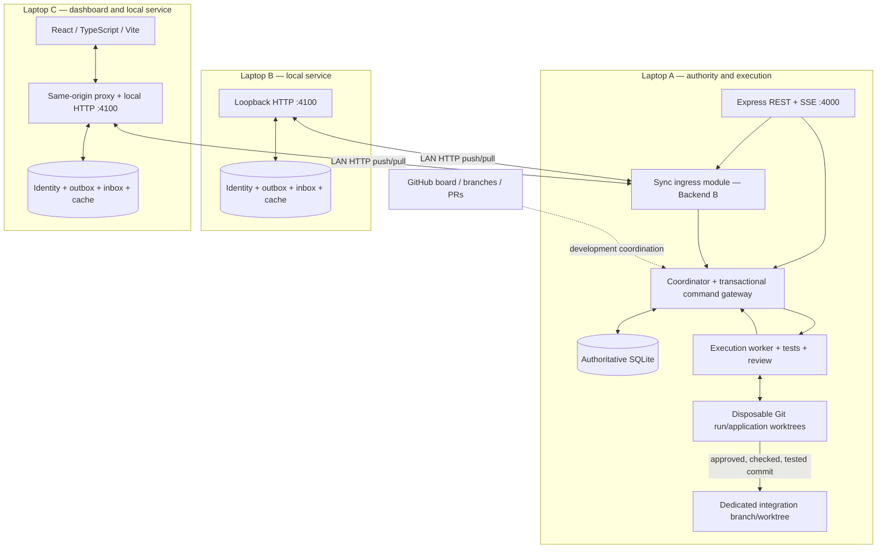
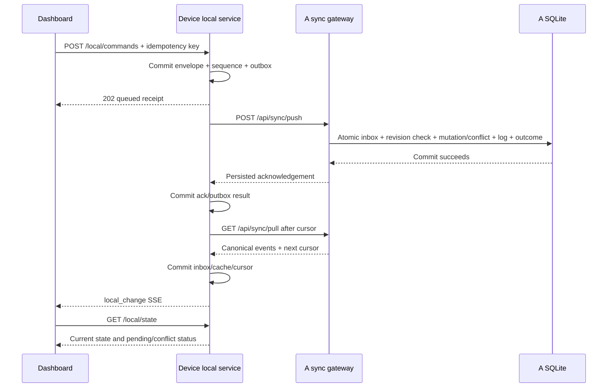

# Upside-Down — shared architecture for every coding assistant

**Architecture baseline: UD-IC/1.0**  
**Prepared: 4 November 2026**  
**Read this file together with `contract.md` and your role-specific master prompt.**

This is the shared system map and implementation guide. `contract.md` remains the canonical source for exact routes, schemas, transactions, lifecycle rules, authentication and acceptance criteria. This overview does not replace it or create a competing contract. If any statement appears inconsistent, stop dependent implementation, identify the discrepancy and coordinate a correction with all affected owners.

## 1. Product and delivery goal

Upside-Down is an **Offline-First Autonomous Multi-Agent Coding Collaboration and Failover Platform**. Developers and coding agents coordinate tasks, preserve progress and detect conflicts despite internet outages. PS-03 (offline-first) is primary; PS-02 supplies supporting bounded autonomous behavior. Three developers have approximately 15–16 hours: Backend A, Backend B and frontend.

The MVP is one authoritative LAN coordinator plus durable device-local services and an honest dashboard. Keep existing working code, make the cross-device loop real, and prove safe review/application with actual evidence. Do not spend the critical path rebuilding a coordinator, adding distributed consensus, integrating a new model, or polishing simulated activity.

Future vision: checkpoint-based cloud-to-local AI task recovery. It must not be presented as implemented. Existing heuristic repair is not a real local LLM, and metadata checkpoints do not contain resumable model execution.

## 2. Verified source baseline versus target system

Read-only GitHub inspection found:

| Ref | State at inspection |
|---|---|
| main | `20eb4f8d865ea1140414355dc7a2f99086d6ed35`; team setup only |
| dikshant/backend | `ec73ff7b1fcc16645484709ea92c51d9dfc46068`; application code |
| PR #3 | Open and unmerged |

Re-fetch and inspect before edits. Do not assume main contains the backend, overwrite dirty work, or silently start from an unrelated branch. Agree baseline and merge strategy with existing owners.

Sources: [repository](https://github.com/DikshantDuggal/Upside-Down), [PR #3](https://github.com/DikshantDuggal/Upside-Down/pull/3), [canonical Message Board](https://github.com/DikshantDuggal/Upside-Down/issues/1), [original inspiration](https://github.com/azizu06/hackathon-agent-board).

| Component | Source-inspected status |
|---|---|
| Node/TypeScript/Express/native SQLite | Present on backend head |
| Task state machine and revision checking | Present |
| Agent registration, event persistence, live SSE | Present |
| Patch proposal/approve/reject records | Present; approval does not apply code |
| Watcher, test runner, bounded heuristic repair, review scanner | Present |
| ExecutionPipeline coordinator calls | Present as class-level integration |
| Server startup activation of ExecutionPipeline | Missing from inspected entrypoint |
| Durable sync/outbox/inbox and per-device services | Proposed; sync contract types alone exist |
| React dashboard | Proposed; web/ absent |
| SSE replay and full mutation/event/outcome transactions | Proposed |
| Authentication and device/reviewer authorization | Proposed |
| Safe patch application/integration jobs | Proposed |
| Real local LLM/cloud-to-local recovery | Future; not implemented |

“Present” means code was read, not that it was independently run during preparation of these files. Historical board test reports are not fresh test results.

## 3. Deployment topology



This diagram is the target topology, not an assertion that all boxes are complete. Each device stores its own database on its local disk. Never share one SQLite file over LAN/SMB. Backend B supplies the same client-local service for every peer laptop. Its server/sync module runs inside A's API process and calls A's gateway.

Internet is unnecessary for LAN HTTP. First-time dependency downloads, GitHub access and cloud models can still require internet; prepare local dependencies before the demo. A's outage is handled by peer queues, not by automatic leader promotion.

## 4. Exact ownership map

| Owner | Exclusive source ownership | Main deliverable |
|---|---|---|
| Backend A | server/core/, server/db/, server/api/, server/agents/, server/workers/, contracts/task.ts, contracts/events.ts, contracts/agent.ts | Authoritative state, execution, safe application, API/SSE |
| Backend B | server/sync/, client-local/, contracts/sync.ts | Device identity, durable queues, sync/router/local service |
| Frontend | web/ | Typed dashboard, real state/evidence, offline/conflict/review experience |

These edit sets do not overlap. Root config/lockfile, server/index.ts, existing server/tests/, AGENTS.md, contract.md and this architecture document are shared controlled integration surfaces. Backend A is the proposed startup/root integrator after applicable handoff, not the automatic owner of every shared file. B/front-end tests belong under their owned paths. Do not modify another owner's implementation without approved handoff.

Dikshant's coordinator ownership is recorded in AGENTS.md and engine ownership was claimed on the board. Remaining human assignments and team lead must be confirmed. Repository ownership does not imply team leadership. All three role owners must explicitly accept UD-IC/1.0; these documents do not claim that has already happened.

## 5. Module boundaries

| Module | Responsibility | Must not do |
|---|---|---|
| Coordinator | Validate lifecycle, revisions and permissions; assign authoritative outcomes | Trust peer revisions/source/reviewer text blindly |
| Coordinator DB | Atomically persist domain changes, canonical log, inbox/outcomes/conflicts/jobs | Hold transactions open while doing network/tests |
| A sync router | Authenticate/validate HTTP and call gateway | Mutate task tables through a second DB connection |
| client-local | Durable identity/outbox/inbox/cache; retry and local API | Become another task authority or expose arbitrary URL proxy |
| Execution pipeline | Run trusted profiles in isolated worktrees, preserve evidence | Edit active developer checkout or accept peer shell strings |
| Patch application | Validate approved immutable patch/base, integrate verified commit | Equate approval with application or overwrite shared branch |
| Dashboard | Render actual state/evidence and submit typed actions | Manufacture agent runs, test passes, delivery or model availability |

A exposes SyncGateway.process/pull/listConflicts/resolve exactly as contract section 4. B exports createSyncRouter(gateway, authenticate). A owns coordinator-side migrations and mounts it; B owns local migrations. Coordinate import/mount/root edits through approved integrator.

## 6. Normal connected workflow



This is proposed synchronization behavior. Implementing only an in-memory queue or a polling fetch does not satisfy it. The browser never allocates authoritative task revisions. A local 202 means locally queued, not remotely applied; the ack determines accepted/conflict/rejected.

## 7. Failure behavior in plain terms

| Failure | Required behavior |
|---|---|
| Internet lost, LAN stays | Product LAN operation continues; GitHub/cloud may fail |
| Peer loses LAN/A | Read cache with stale label, commit local commands to durable queue |
| Peer service restarts | Reopen same device DB; preserve identity, sequence, queue and cursor |
| A commits but ACK is lost | Same command retries; stored outcome returns, mutation is not repeated |
| Two devices use old revision | One may apply; stale proposal becomes visible conflict |
| A crashes | Restart authority from durable DB; interrupted execution jobs require reconciliation |
| Storage fails | Return real error and preserve pending data; never falsely claim queued/delivered |
| Code base changes | Block application, request new patch/rebase/review and tests |

Coordinator reachability, LAN availability, internet availability and local-service availability are different states. navigator.onLine alone proves none of the necessary server guarantees. A is a single point of authority; no multi-master or automatic cloud/local recovery is promised.

## 8. State and protocol invariants

1. One authoritative task revision per accepted mutation, starting at 1. baseRevision must equal current revision.
2. Stable UUID event ID across retries; immutable payload; persistent UUID device ID and positive monotonic device sequence.
3. One transaction at A covers inbox deduplication, mutation/conflict/rejection, canonical events, stored ack and sequence advancement.
4. Terminal acks are applied/conflict/rejected. Retry is nonterminal. A conflict is delivered but unresolved work, not transport failure.
5. One local transaction covers command+sequence allocation; another covers pulled inbox/cache/cursor. Never advance cursor without persisting the events.
6. Canonical cursor/epoch orders the journal; timestamps and peer sequences are not global ordering.
7. Replay/dedup never generates a new outbound copy of a received event.
8. SSE is a notification path; durable pull log is replication source. Current SSE does not support replay.
9. Reviewer identity is authenticated; text reviewerId is not authorization.
10. Approval, application, passing verification and GitHub merge are separate facts.

A stale revision never overwrites current task data. Conflict resolution includes expected conflict revision and current task revision, revalidates lifecycle, and is reviewer/admin-only. Code conflicts additionally use base-commit/path checks; task conflict resolution is not semantic code merging.

## 9. Existing REST/SSE compatibility

Implemented on inspected backend branch:

| Area | Routes |
|---|---|
| Health | GET /api/health |
| Tasks | GET/POST /api/tasks; GET /api/tasks/:id; POST /api/tasks/:id/transition |
| Agents | GET /api/agents; POST /api/agents/register |
| Events | GET /api/events; GET /api/events/stream |
| Patches | POST /api/patches; GET /api/patches/:id; POST /api/patches/:id/approve; POST /api/patches/:id/reject |

Task create/transition return direct Task objects; lists are direct arrays. SSE sends named activity frames with id=event.id; listen with addEventListener('activity', ...). Current history uses strictly timestamp > since and default limit 100, which is insufficient for exact replay. Do not invent a generic data wrapper or assumed patch list.

Proposed additions are specified exactly in contract section 6: sync push/pull/conflicts/resolve; capabilities; runs/read/cancel; task patch list/checkpoints; apply/application status; local health/commands/receipt/state/events. Capability flags advertise only features actually implemented and verified. Missing capabilities route means legacy mode, not implicit UD-IC compliance.

Queued commands are task.create, task.transition, message.send. Run controls and patch decisions/application stay online-only and separately authorized. Frontend always uses local commands for queueable actions; it never double-submits through legacy POST and outbox.

## 10. Execution and patch safety

Existing flow: debounced file watcher → subprocess tests → task for test failure → up to three heuristic attempts → candidate verification → review result → pending patch. Important gaps: startup does not activate it; supplied workspace is edited temporarily rather than enforced worktree isolation; review verdict is not an enforcement gate; exceptions/crashes can interrupt restoration.

Required target flow:

```mermaid
flowchart LR
  T["Accepted task"] --> R["Durable run + isolated worktree"]
  R --> B["Baseline tests"]
  B --> H["Bounded heuristic repair"]
  H --> V["Validate diff + review + candidate tests"]
  V --> P["Pending patch"]
  P --> D["Human approval decision"]
  D --> A["Explicit application job"]
  A --> C["Recheck task revision + base + diff hash"]
  C --> I["Apply/test/commit in controlled workspace"]
  I --> F["Guarded integration + evidence + task done"]
```



Any unsafe/failing/stale stage becomes blocked/failed with evidence; it must not advance along the success path. Approval currently marks a review task done without changing code. In the proposed verified_application mode, approval leaves review; only verified application may complete it. Announce and coordinate this semantic migration while preserving route/body compatibility. Historical done records are not retroactively verified.

Use fixed workspace/test-profile IDs resolved server-side, clean dedicated integration target, exact base commit, immutable diff hash and locks. Validate both old/new paths, renames/deletes, traversal, secrets, .git, ownership, junctions/symlinks and case aliases. Protect tests from heuristic changes. git apply --check and real tests are required; regex safety review is insufficient. Reconcile a crash after Git commit but before DB update using durable job markers. Never reset/stash/overwrite a developer's active checkout.

Record actual executable profile, timestamps, exit code, timeout, stdout/stderr truncation, tested tree/commit and resulting integration commit. A string that says PASS is not evidence. Agent runtimeAvailable does not prove LLM execution. Worktrees isolate code changes, not hostile process privileges; trusted demo fixtures remain the safety boundary.

## 11. Frontend experience

Build overview, agent cards, task list/detail, activity timeline, safe code diff viewer, patch decision/application controls, actual tests/evidence, network status, pending queue and conflict resolution.

Always distinguish:

- Canonical task status from queued local proposal.
- Fresh data from cached/stale data.
- Local queue acceptance from A's acknowledgement.
- Agent registration from actual execution and model availability.
- Approval decision from applied/verified code.
- Legacy testOutput text from server-produced TestEvidence.
- Future cloud/local recovery from current metadata.

Bootstrap local state with its localCursor, subscribe after that watermark and refetch on local_change. Deduplicate remote activity by event ID and reconcile by revision. Handle reset/epoch changes explicitly. Legacy SSE reconnects require snapshot/history refresh with possible gap disclosure. Show actionable loading/error/empty/authorization states; never hide unavailable backend functionality with mock success.

## 12. Security and configuration

Current server is unauthenticated with broad CORS and binds 0.0.0.0:4000. Before LAN exposure implement scoped device credentials, separate reviewer authorization, runtime validation, size limits, origin/CSRF rules and secret-safe errors. Device token principal must match envelope identity. No peer-provided shell commands, arbitrary filesystem roots or generic forwarding URLs.

Keep tokens in protected local service configuration; no bearer query params, browser localStorage or public Vite environment. Use same-origin browser session/local proxy for EventSource. Trusted private LAN HTTP is a declared demo limitation; use HTTPS/tunnel for untrusted networks. Do not disable the whole firewall.

Implemented PORT defaults 4000; DB path is cwd/data/upside_down.db or injected createServer(dbPath). Other UD_* settings are proposed, not implemented: UD_HOST, UD_DB_PATH, UD_COORDINATOR_URL, UD_LOCAL_PORT, UD_DEVICE_DB, UD_DEVICE_TOKEN_FILE, UD_ALLOWED_ORIGINS, UD_WORKSPACE_CONFIG and UD_PATCH_COMPLETION_MODE. Contract section 18 defines intended meanings. Local service defaults loopback:4100; browser uses same-origin proxy. Each service instance needs unique DB/identity/port.

## 13. Startup and integration sequence

First recheck Git/ownership:

```powershell
git status --short
git branch --show-current
git fetch origin
git rev-parse origin/main
git rev-parse origin/dikshant/backend
git show origin/main:AGENTS.md
gh pr view 3 --repo DikshantDuggal/Upside-Down --json state,mergedAt,headRefOid,headRefName,baseRefName
```

On approved backend checkout containing inspected application source, supported commands:

```powershell
node --version
npm --version
node -e "const s=require('node:sqlite'); console.log(typeof s.DatabaseSync)"
npm install
npm run typecheck
npm run test:coordinator
npm run test:agent
npm test
$env:PORT='4000'
npm start
```

Use npm install because inspected tree had no lockfile; npm ci requires a real committed matching lockfile. Team reported Node 24 baseline; verify actual machine. Root build is tsc with noEmit and does not create deployable JS. Existing tests use fixed port/data directory: run sequentially until isolation is improved.

Separate terminal smoke checks:

```powershell
Invoke-RestMethod 'http://127.0.0.1:4000/api/health'
Invoke-RestMethod 'http://127.0.0.1:4000/api/tasks'
curl.exe -N 'http://127.0.0.1:4000/api/events/stream'
```

These reflect unauthenticated source baseline; add credentials after hardening. No existing local/frontend start scripts were found. Owners must implement, run and publish client-local dev/test and web dev/build/test/test:e2e scripts before others rely on them. Document actual ports, enrollment, proxy and workspace configuration. Git for Windows/worktree behavior, npm command handling, process-tree cancellation, CRLF, locked files and paths with spaces need real Windows checks.

## 14. Continuous integration checkpoints

| Time | Shared checkpoint |
|---|---|
| 0–1 h | Accept contract/base/ownership; run baseline; agree gateway/proxy |
| 1–4 h | A transactional core/startup; B durable local queue; frontend real REST UI |
| 4–7 h | One real task/message round trip across two services with live dashboard |
| 7–10 h | Restart/reconnect/conflict flow and controlled patch application |
| 10–13 h | Failure injection, two-device tests, security/Windows checks |
| 13–16 h | Regression, demo rehearsal, evidence and precise handoff |

Cut discovery, new model providers and cosmetic polish before durability or truthfulness. Report blockers immediately; do not wait until final merge to discover incompatible schemas.

## 15. Demonstration and completion evidence

Required end-to-end proof: two distinct device databases/services, one A; cut internet but retain LAN; create/share work; disconnect a device and queue work; restart it; reconnect; see one accepted mutation after dropped-ACK retry; show stale revision conflict and authorized resolution; review an actual patch; approval alone leaves files unchanged; apply safely and show real commit/tests; failing/unsafe/stale patch never reports done.

Test existing backend regressions plus transaction crash boundaries, replay/reset, invalid/reused IDs, auth/device/reviewer permissions, local cursor/cache atomicity, dirty/stale integration base, malicious paths, worker timeout/cancel/restart and UI freshness. Contract section 21 is the full acceptance matrix. Record exact branch/SHA, OS/runtime, commands, exit codes, actual evidence and unresolved limitations. Never fabricate tests, sync, model execution or verified features.

Each assistant hands off exact owned paths/commits, setup/migration/config, interface capabilities, actual tests and blockers. Separate branches, explicit staging, small commits, fresh remote checks and no force-pushing shared branches. Coordinate changes on the canonical board using verified human identities; do not claim a post or approval that did not occur. Do not modify repositories merely because this documentation exists: implementation must occur under its own authorized task.

## 16. What every AI receives

Give each coding assistant the same **architecture.md + contract.md** plus exactly its role-specific prompt:

| Assistant | Specific prompt |
|---|---|
| Backend A | 01_Backend_A_Master_Prompt.md |
| Backend B | 02_Backend_B_Master_Prompt.md |
| Frontend | 03_Frontend_Master_Prompt.md |

The mentorship mindmap is a presentation aid, not an API specification. UD-IC/1.0 remains canonical. Open assumptions: contract acceptance, human role assignments/lead, PR baseline integration, deployment addresses, reviewer enrollment mechanism, real test profiles and dedicated integration branch. None is silently resolved by generating these files.
