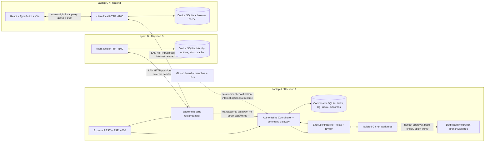

# Upside-Down canonical integration contract

**Version: UD-IC/1.0**  
**Prepared: 4 November 2026 (Asia/Calcutta)**  
**Status: canonical proposed integration baseline, pending explicit acceptance by all three developers.** This document does not claim that its proposed extensions are implemented, deployed, approved by the team, or tested.

## 1. Purpose, scope, and evidence

Upside-Down is an Offline-First Autonomous Multi-Agent Coding Collaboration and Failover Platform. It connects developers and coding agents on a LAN, coordinates tasks, preserves progress, detects stale proposals and conflicting code changes, and continues local operations during internet outages. PS-03 (offline-first) is primary; PS-02 (zero-prompt AI) supports bounded automatic triggers. The hackathon budget is 15–16 hours for two backend developers and one frontend developer.

MVP: one authoritative coordinator; durable SQLite per device; HTTP LAN push/pull; acknowledgements and deduplication; visible stale-revision conflicts; REST/SSE dashboard; bounded existing repair provider; human review; controlled patch application with actual test evidence. Internet disconnection must not break LAN operation. Coordinator disconnection allows local reads and durable proposals, but no independent authoritative task revision, shared code application, or leader election.

Future only: checkpoint-based cloud-to-local AI recovery, interchangeable real local LLM execution, transparent migration of model context, multi-coordinator consensus, automatic semantic merging, and production sandboxing. Checkpoint metadata in this contract is not proof of resumable AI execution. The existing offline heuristic provider is not a local LLM.

### Source snapshot and implemented/proposed labels

Read-only GitHub inspection found:

| Ref | Observed state |
|---|---|
| `main` | `20eb4f8d865ea1140414355dc7a2f99086d6ed35`; board setup, no application source/package.json |
| `dikshant/backend`, PR #3 head | `ec73ff7b1fcc16645484709ea92c51d9dfc46068`; PR OPEN, NOT MERGED |
| Other observed branches | `1-board-workflow` at `37851f834344df3464c7629e86afa74a3f268361`; `dikshat/backend-proto-g` at `62cab46a66f706d0005d7b62b32aa475cf106e64` |

Sources: [repository](https://github.com/DikshantDuggal/Upside-Down), [PR #3](https://github.com/DikshantDuggal/Upside-Down/pull/3), [canonical Message Board](https://github.com/DikshantDuggal/Upside-Down/issues/1), [inspiration](https://github.com/azizu06/hackathon-agent-board). Source links below pin the inspected commit. Recheck all refs before coding; branch names alone are not immutable evidence.

**IMPLEMENTED** below means present in source at that backend SHA, not merged to main or independently executed during this documentation task. Existing tests comprise six coordinator scenarios and five agent-engine scenarios; board reports of passing tests are historical reports, not fresh verification here.

Implemented: coordinator state machine; SQLite task/agent/event/patch records; HTTP routes in section 5; live SSE; task revision checks; watcher; subprocess tests; bounded heuristic repair; patch review scanner; ExecutionPipeline class. `contracts/sync.ts` contains types only; there is no `server/sync/`, `client-local/`, or `web/` in this snapshot.

Important source limitations:

- `server/index.ts` creates the coordinator and router, but does not construct/start ExecutionPipeline. The existing class accepts an optional coordinator; class-level integration is not startup integration.
- `approvePatch` marks a patch approved and changes a review task to done, without Git application or merge. Rejection changes review to running. Preserve legacy wire shapes while correcting completion semantics as an explicitly coordinated change.
- Task changes and event inserts are separate statements, not a single transaction. Revision-guarded UPDATE exists, but full command/event/outcome atomicity does not.
- `saveEvent` uses INSERT OR IGNORE, while publishEvent still broadcasts; duplicate external event IDs can be broadcast again.
- SSE sends IDs but ignores Last-Event-ID; timestamp-only event history has no stable cursor. No durable replay guarantee exists.
- Repair writes candidates into the supplied workspace and restores on normal paths. `worktreeDir` is not used to enforce isolation; exceptions/crashes can interrupt restore. Review verdict is recorded but does not gate proposing the patch. These are implementation gaps, not certified execution safety.
- Current CORS is unrestricted; authentication/device authorization is absent; runtimeAvailable is not evidence of a model. No lockfile was present in the inspected tree.

## 2. Architecture and data flow



Diagram describes the target; inspect section 1 for implemented pieces. Backend B code also runs on A as the sync ingress module. A owns the mount and coordinator storage transaction. Each laptop has its own SQLite files on its own local disk, never a shared database over SMB. The browser is a view/client, not an authority.

Typical flow: browser writes a local command → local service validates and commits outbox → push batch → A validates identity/revision → one transaction persists inbox, coordinator mutation or conflict, canonical events and outcome → response acknowledges durable processing → local service commits ack/cache → pull canonical events → persist inbox/cache/cursor → publish local SSE → UI refreshes authoritative data. Execution is scheduled only by A from accepted work and never from arbitrary peer shell commands.

## 3. Deployment and failure behavior

| Condition | Required behavior (PROPOSED unless already noted) |
|---|---|
| Internet lost, LAN intact | APIs, sync, SQLite, bounded heuristic repairs and UI continue; board/cloud become unavailable |
| Peer loses LAN/A | Cached data marked stale; local commands queued durably; no claim of remote delivery or completed execution |
| A stops | Peers queue, A DB remains authoritative; restart recovers log/outcomes/jobs; no automatic promotion |
| ACK response lost | Resend identical event ID/sequence/payload; A returns original outcome without repeating mutation |
| Local process restarts | Persistent identity/next sequence/outbox/cursor restored; in-flight rows retry |
| Disk full/SQLite busy | No false queued/delivered response; rollback and bounded retry; surface actionable storage failure |
| Browser closes | Already accepted local commands survive in SQLite; browser cache alone is not delivery evidence |
| Coordinator DB restored backwards | Coordinator epoch changes; cursor reset/resnapshot required; never silently reuse old cursor positions |

A currently listens on `0.0.0.0:4000`. Restrict firewall to the private demo LAN and add authorization before exposing it. Local service binds `127.0.0.1:4100` by default. A uses configured explicit coordinator URL/IP; discovery is optional and out of critical path. Browser-to-local calls use a same-origin Vite proxy or same-origin production server. Pre-install dependencies before internet is cut; offline-first does not mean first-time npm installation works offline.

## 4. Ownership and integration boundaries

The three roles below are the requested target allocation, not an assertion that GitHub users have accepted all assignments. Dikshant's core ownership is in AGENTS.md; board comment 6611441511 also claims agent engine ownership and 6611576472 reports its handoff. AGENTS.md still lists other areas unassigned. Humans must confirm Backend B/frontend identities and leadership. Do not infer leadership from repository ownership.

| Role | Exclusive edit ownership |
|---|---|
| Backend A — Coordinator and Execution | `server/core/`, `server/db/`, `server/api/`, `server/agents/`, `server/workers/`, `contracts/task.ts`, `contracts/events.ts`, `contracts/agent.ts` |
| Backend B — Offline Communication and Synchronization | `server/sync/`, `client-local/`, `contracts/sync.ts` |
| Frontend — Dashboard | `web/` |

Nonoverlap is intentional. Shared/root files are not automatically owned by any of these sets: `contract.md`, `AGENTS.md`, `server/index.ts`, root `package.json`/lockfile/tsconfig, and existing `server/tests/`. A is the designated proposed integrator for entrypoint/root config/server test edits, but must obtain the applicable owner/lead handoff first. B puts tests below B-owned directories; frontend tests stay in `web/`; A may add tests under `server/core/__tests__/` or other A-owned directories. No cross-owner edits disguised as generated files. All three must accept the same UD-IC/1.0 before implementation. Changes to shared interfaces require recorded A+B+frontend agreement and actual owner approval on the board. If internet is down, record decisions locally and exchange on LAN; post when restored, without claiming a post occurred.

### A/B gateway (PROPOSED; types declared in B-owned contracts/sync.ts)

```ts
interface SyncGateway {
  // Owns one atomic coordinator DB transaction per event.
  process(event: CommandEnvelope, principal: Principal): Promise<Ack>;
  // Canonical durable journal, not timestamp history.
  pull(after: string | undefined, limit: number, principal: Principal): Promise<PullResponse>;
  listConflicts(status: "open" | "resolved", after?: string): Promise<ConflictPage>;
  resolve(id: string, input: ResolveRequest, principal: Principal): Promise<ConflictRecordV1>;
}
interface Principal {
  id: string;
  deviceId: string;
  role: "device" | "reviewer" | "admin";
}
// Backend B exports createSyncRouter(gateway: SyncGateway, authenticate: middleware).
// Backend A mounts it at /api/sync and implements the gateway inside server/core/.
// A also owns coordinator-side inbox/log/conflict migrations in server/db/.
```

B's A-side adapter calls only the gateway. Do not implement a second task state machine or invoke createTask/transitionTask outside the gateway transaction. A must expose a transaction-aware command service rather than B starting a transaction on a separate connection. No remote network request or test subprocess may run inside a SQLite transaction.

## 5. IMPLEMENTED backend REST API

Base URL: `http://<A-LAN-IP>:4000/api`. JSON bodies use Content-Type application/json. Arrays and objects are returned directly, not wrapped in invented `data` envelopes. Optional properties are omitted, not required null. Source: [routes.ts](https://github.com/DikshantDuggal/Upside-Down/blob/ec73ff7b1fcc16645484709ea92c51d9dfc46068/server/api/routes.ts).

| Method / route | Exact request/query | Success |
|---|---|---|
| GET `/api/health` | none | 200 `{status:"ok",timestamp,role:"Role 1: Core Backend & Coordinator",protocolVersion:"1.0",activeSubscribers:number}` |
| GET `/api/tasks` | optional `status=TaskStatus` | 200 `Task[]`, createdAt descending |
| POST `/api/tasks` | `TaskCreateRequest` | 201 `Task`, pending/revision 1 |
| GET `/api/tasks/:id` | path ID | 200 `Task` |
| POST `/api/tasks/:id/transition` | `TaskTransitionRequest` | 200 updated `Task`; revision +1 |
| GET `/api/agents` | none | 200 `AgentInfo[]`, name ascending |
| POST `/api/agents/register` | `{id,name,status?,runtimeAvailable?,currentTaskId?}` | 200 `{success:true}`; server stamps lastSeenAt; status defaults idle and runtimeAvailable defaults true |
| GET `/api/events` | `taskId?`, `since?` ISO timestamp, `limit?` default 100 | 200 `ActivityEvent[]`; ascending timestamp, strictly timestamp > since |
| GET `/api/events/stream` | no supported replay parameters | 200 text/event-stream; see section 10 |
| POST `/api/patches` | `{taskId,runId,diffContent,testOutput?,patchPath?}` | 201 `PatchRecord`; running task moves to review |
| GET `/api/patches/:id` | patch ID | 200 `PatchRecord` |
| POST `/api/patches/:id/approve` | `{reviewerId?:string}` | 200 `PatchRecord` with approved status; currently review task moves done, no apply |
| POST `/api/patches/:id/reject` | `{reviewerId?:string,reason?:string}` | 200 rejected `PatchRecord`; review task moves running |

No implemented endpoint lists all patches, starts a run, reads checkpoints, synchronizes peers, resolves durable conflicts, or applies code. GET task does not embed patches. Frontend obtains patch IDs from patch_proposed events or proposed `/api/tasks/:id/patches`; never assume a missing route exists.

Current error bodies: 400 `{error:"Bad Request",message:string}`; 404 `{error:"Not Found",message:string}`; 409 `{error:"Conflict",message:string,currentRevision:number,baseRevision:number}`; 500 `{error:"Internal Server Error",message:string}`. This mapping is router-level; malformed JSON/unknown paths can use Express defaults. UI must tolerate non-JSON errors. Current runtime validation is partial (for example numeric coercion of baseRevision, unbounded limit, permissive agent fields), not a security guarantee.

## 6. PROPOSED additions and exact HTTP interfaces

All routes in this section are **PROPOSED, absent from the inspected server**. They share UD-IC/1.0 schemas below. `X-UD-Contract: UD-IC/1.0` is required on new requests/responses (except native SSE; see section 17). Authorization is required. Unsupported version → 426. New JSON errors use ErrorV1. Route path includes `/api` exactly once.

| Owner | Method / route | Request | Success |
|---|---|---|---|
| B router / A gateway | POST `/api/sync/push` | PushRequest | 200 PushResponse, including per-event outcomes; whole malformed batch → 400 |
| B router / A gateway | GET `/api/sync/pull` | `after?` opaque cursor, `limit?` 1..200 default 100 | 200 PullResponse; unknown/expired epoch cursor → 410 ErrorV1 with code CURSOR_EXPIRED |
| B router / A gateway | GET `/api/sync/conflicts` | `status?` open/resolved default open, `after?` conflict ID cursor | 200 ConflictPage, max 100 |
| B router / A gateway | POST `/api/sync/conflicts/:id/resolve` | ResolveRequest | 200 ConflictRecordV1; reviewer/admin only |
| A | GET `/api/capabilities` | none | 200 Capabilities |
| A | POST `/api/tasks/:id/runs` | `{baseRevision:number,workspaceId:string,testProfileId:string,trigger:"manual"}`, Idempotency-Key | 202 RunRecord; server allocates runId and isolated workspace |
| A | GET `/api/runs/:id` | none | 200 RunRecord |
| A | POST `/api/runs/:id/cancel` | `{reason:string}`, Idempotency-Key | 200 RunRecord with cancellationRequested:true; terminal status only once worker stopped |
| A | GET `/api/tasks/:id/patches` | none | 200 PatchRecordV1[], createdAt ascending |
| A | POST `/api/patches/:id/apply` | ApplyRequest, Idempotency-Key | 202 ApplicationRecord; reviewer/admin only |
| A | GET `/api/applications/:id` | none | 200 ApplicationRecord |
| A | GET `/api/tasks/:id/checkpoints` | none | 200 Checkpoint[]; metadata only, empty if none |
| B local | GET `/local/health` | none | 200 LocalHealth |
| B local | POST `/local/commands` | LocalCommandRequest, Idempotency-Key | 202 LocalReceipt after SQLite commit |
| B local | GET `/local/commands/:eventId` | none | 200 LocalReceipt including ack if known |
| B local | GET `/local/state` | none | 200 LocalState; full persisted cache with watermark |
| B local | GET `/local/events/stream` | `after?` local cursor; Last-Event-ID supported | 200 SSE, local_change and reset events |

`Capabilities = {contractVersion:"UD-IC/1.0",features:{sync:boolean,sseReplay:boolean,execution:boolean,patchApply:boolean,checkpointMetadata:boolean},patchCompletionMode:"legacy_decision"|"verified_application"}`. Flags become true only when implemented and verified. Until route exists, frontend uses explicit legacy mode and labels approval as decision only. Deployment must not advertise verified_application until A changes approve-to-done behavior and all three clients agree. Existing health protocolVersion "1.0" is a legacy value, not proof of UD-IC/1.0 compliance.

Local service also exposes same-origin read proxies for existing GET `/api/health`, `/api/tasks[?status]`, `/api/tasks/:id`, `/api/agents`, `/api/events[?taskId&since&limit]`, `/api/patches/:id`, `/api/events/stream` and proposed capabilities/run/application/patch-list/checkpoint reads. When A is reachable these forward responses; when disconnected, supported cached reads return their usual shape plus `X-UD-Stale: true` and `X-UD-Cached-At` ISO time; uncached reads → 503. `/local/state` is the canonical cache/bootstrap response. SSE proxy does not invent remote replay; offline proxy disconnection is visible, with local events on a separate stream. Do not implement a generic proxy accepting arbitrary URLs.

Frontend uses POST /local/commands for queued task.create, task.transition, and message.send, even when connected. Never submit the same action via both direct legacy POST and outbox. Agent registry, patch decisions, apply, and run start/cancel are online-only through local authenticated allowlisted proxy to A, using their exact routes. An online-only failure is not silently enqueued. Tokens stay in local service, never in Vite build variables.

Local browser idempotency key ensures retry after a lost local response returns the original envelope. Local service alone allocates device sequence and event ID. Local approval controls require a separate reviewer session, not the broad device token.

## 7. TypeScript schemas and examples

These declarations use JSON-safe values, ISO UTC strings, integer revisions >=1, sequences >=1, and UUIDv4 IDs unless a field is explicitly a configured identifier or opaque cursor. Legacy IDs are strings; existing callers need not migrate their historical IDs. New generated IDs are UUIDv4. Omit undefined properties when serializing. Schemas here are normative for proposed work; implement runtime validation as TypeScript alone does not validate HTTP.

### Existing wire types (IMPLEMENTED)

```ts
type TaskStatus = "pending" | "assigned" | "running" | "review" | "done" | "blocked" | "failed";
interface Task {
  id: string; title: string; description?: string; status: TaskStatus;
  ownerId?: string; revision: number; createdAt: string; updatedAt: string;
}
interface TaskCreateRequest { title: string; description?: string; ownerId?: string }
interface TaskTransitionRequest {
  targetStatus: TaskStatus; baseRevision: number; ownerId?: string; reason?: string;
}
interface AgentInfo {
  id: string; name: string; status: "idle" | "running" | "offline" | "error";
  runtimeAvailable: boolean; currentTaskId?: string; lastSeenAt: string;
}
interface ActivityEvent {
  id: string; taskId?: string; source: string; type: string;
  timestamp: string; payload: Record<string, unknown>;
}
interface PatchRecord {
  id: string; taskId: string; runId: string; status: "pending" | "approved" | "rejected";
  patchPath?: string; diffContent: string; testOutput?: string; createdAt: string;
  reviewedAt?: string; reviewerId?: string; rejectionReason?: string;
}
interface AgentRunRequest {
  runId: string; taskId: string; workspacePath: string;
  trigger: "test_failed" | "manual"; testOutput?: string; failedTestName?: string;
}
interface AgentRunResult {
  runId: string; status: "completed" | "failed" | "blocked" | "cancelled" | "timeout";
  patchPath?: string; diffContent?: string; testOutput?: string;
  verificationOutput?: string; error?: string; durationMs: number; attempts: number;
}
```

Current contracts/sync.ts has only the following legacy types; retain exported names/fields for compatibility and add the V1 types below rather than silently redefining them:

```ts
interface SyncEvent {
  eventId: string; deviceId: string; sequence: number; taskId?: string;
  baseRevision?: number; type: string; payload: Record<string, unknown>;
}
interface ConflictRecord {
  id: string; taskId: string; localRevision: number; incomingRevision: number;
  localPayload: Record<string, unknown>; incomingPayload: Record<string, unknown>;
  detectedAt: string; resolved: boolean;
  resolution?: "accepted_incoming" | "kept_local" | "custom_merge";
}
```

### Proposed command, event, sync, and conflict types

```ts
type Version = "UD-IC/1.0";
type Command =
  | { type: "task.create"; payload: { clientTaskId: string; title: string; description?: string; ownerId?: string } }
  | { type: "task.transition"; taskId: string; baseRevision: number; payload: { targetStatus: TaskStatus; ownerId?: string; reason?: string } }
  | { type: "message.send"; payload: { messageId: string; text: string; taskId?: string; recipientDeviceId?: string } };
type CommandEnvelope = Command & {
  contractVersion: Version; eventId: string; deviceId: string;
  sequence: number; createdAt: string;
};
type LocalCommandRequest = Command; // service adds identity/time/sequence
interface Message {
  id: string; eventId: string; senderDeviceId: string; text: string;
  taskId?: string; recipientDeviceId?: string; createdAt: string; receivedAt: string;
}
interface CanonicalEvent extends ActivityEvent {
  contractVersion: Version; cursor: string; coordinatorEpoch: string;
  originEventId?: string; originDeviceId?: string; originSequence?: number;
}
interface PushRequest { contractVersion: Version; deviceId: string; events: CommandEnvelope[] }
interface Ack {
  eventId: string; deviceId: string; sequence: number;
  status: "applied" | "conflict" | "rejected" | "retry";
  duplicate: boolean; taskId?: string; revision?: number; conflictId?: string;
  canonicalEventIds: string[]; error?: ErrorV1;
}
interface PushResponse {
  contractVersion: Version; acks: Ack[]; receivedThrough: number; serverTime: string;
}
interface PullResponse {
  contractVersion: Version; events: CanonicalEvent[]; nextCursor: string;
  hasMore: boolean; serverTime: string;
}
interface ConflictRecordV1 {
  contractVersion: Version; id: string; taskId: string; eventId: string;
  deviceId: string; baseRevision: number; currentRevision: number;
  proposed: Extract<Command, { type: "task.transition" }>;
  currentTask: Task; detectedAt: string; status: "open" | "resolved";
  resolutionRevision: number; resolvedAt?: string; resolvedBy?: string;
  resolution?: "keep_authoritative" | "retry_proposal" | "custom_transition";
  resultingTaskRevision?: number;
}
interface ResolveRequest {
  resolution: "keep_authoritative" | "retry_proposal" | "custom_transition";
  expectedConflictRevision: number; expectedTaskRevision: number;
  transition?: { targetStatus: TaskStatus; ownerId?: string; reason: string };
  reason: string;
}
interface ConflictPage { items: ConflictRecordV1[]; nextCursor?: string; hasMore: boolean }
interface ErrorV1 {
  error: string; code: string; message: string; requestId: string; retryable: boolean;
  details?: { currentRevision?: number; baseRevision?: number; conflictId?: string;
    expectedSequence?: number; retryAfterMs?: number; [key: string]: unknown };
}
interface LocalReceipt {
  eventId: string; deviceId: string; sequence: number;
  state: "queued" | "sending" | "applied" | "conflict" | "rejected";
  queuedAt: string; attempts: number; ack?: Ack; lastError?: ErrorV1;
}
interface LocalHealth {
  contractVersion: Version; deviceId: string;
  coordinatorReachable: boolean; internetReachable: "unknown" | boolean;
  pendingCount: number; lastSyncAt?: string; lastError?: ErrorV1;
}
interface LocalState {
  contractVersion: Version; deviceId: string; localCursor: string; remoteCursor?: string;
  cachedAt?: string; stale: boolean; tasks: Task[]; agents: AgentInfo[];
  events: CanonicalEvent[]; patches: PatchRecordV1[]; messages: Message[];
  conflicts: ConflictRecordV1[]; pending: LocalReceipt[]; health: LocalHealth;
}
```

Task creation carries clientTaskId for stable offline references. A accepts that ID only after UUID validation and uniqueness check. Legacy POST /api/tasks still generates a server UUID. A duplicate clientTaskId under a different event ID is rejected TASK_ID_EXISTS (not overwrite). messageId follows the same uniqueness rule; sender is authenticated, never taken from text. `recipientDeviceId` omitted means team broadcast; direct messages and their journal entries are filtered by authorization. Pull cursor advances over invisible rows, avoiding an endless empty page. No peer can submit a canonical event or a patch approval through the sync command union.

### Proposed execution, patch, and checkpoint types

```ts
interface TestEvidence {
  id: string; runId: string; commandProfileId: string; startedAt: string; endedAt: string;
  exitCode: number | null; timedOut: boolean; passed: boolean;
  stdout: string; stderr: string; truncated: boolean; testedCommit?: string; treeHash: string;
}
interface Checkpoint {
  id: string; taskId: string; runId: string; deviceId: string;
  baseCommit: string; taskRevision: number; stage: string; createdAt: string;
  artifactHash?: string; summary: string; recoveryCapability: "metadata_only";
}
interface RunRecord {
  id: string; taskId: string; baseRevision: number; workspaceId: string;
  baseCommit: string; provider: "offline-heuristic-provider";
  status: "queued" | "running" | "review" | "completed" | "failed" | "blocked" | "cancelled" | "timeout";
  stage: "queued" | "baseline" | "repair" | "verification" | "review" | "finished";
  attempts: number; maxAttempts: number; cancellationRequested: boolean;
  createdAt: string; startedAt?: string; endedAt?: string;
  patchId?: string; evidence: TestEvidence[]; error?: ErrorV1;
}
interface PatchRecordV1 extends PatchRecord {
  baseCommit?: string; taskRevision?: number; diffHash?: string;
  review?: { safe: boolean; score: number; reasons: string[]; touchedFiles: string[] };
  applicationStatus?: "not_applied" | "queued" | "applying" | "verified" | "failed" | "blocked";
  applicationId?: string; evidence?: TestEvidence[];
}
interface ApplyRequest {
  expectedTaskRevision: number; expectedBaseCommit: string; expectedDiffHash: string;
  targetWorkspaceId: string; testProfileId: string;
}
interface ApplicationRecord {
  id: string; patchId: string; taskId: string;
  status: "queued" | "applying" | "verified" | "failed" | "blocked";
  expectedBaseCommit: string; targetWorkspaceId: string; diffHash: string;
  requestedBy: string; requestedAt: string; startedAt?: string; endedAt?: string;
  commit?: string; evidence: TestEvidence[]; error?: ErrorV1;
}
```

Internal AgentRunRequest.workspacePath is server-resolved, never accepted as arbitrary HTTP input. Checkpoint summary must exclude secrets and hidden model reasoning. Current patchPath is legacy metadata; never read an arbitrary client-supplied disk path. Proposed patches intended for application must have baseCommit, taskRevision and diffHash; absent metadata means application blocked until safely reproposed. `completed` for a run means its bounded repair job ended, not that a patch is integrated.

### JSON examples (illustrative fixtures, not observed execution)

```json
{
  "task": {"id":"11111111-1111-4111-8111-111111111111","title":"Repair parser","status":"running","ownerId":"agent-1","revision":3,"createdAt":"2026-11-03T19:00:00.000Z","updatedAt":"2026-11-03T19:01:00.000Z"},
  "agent": {"id":"agent-1","name":"Heuristic repair worker","status":"idle","runtimeAvailable":true,"lastSeenAt":"2026-11-03T19:01:00.000Z"},
  "event": {"id":"22222222-2222-4222-8222-222222222222","taskId":"11111111-1111-4111-8111-111111111111","source":"api","type":"task_transitioned","timestamp":"2026-11-03T19:01:00.000Z","payload":{"from":"assigned","to":"running","revision":3}},
  "message": {"id":"33333333-3333-4333-8333-333333333333","eventId":"44444444-4444-4444-8444-444444444444","senderDeviceId":"55555555-5555-4555-8555-555555555555","text":"Parser review ready","createdAt":"2026-11-03T19:01:00.000Z","receivedAt":"2026-11-03T19:01:02.000Z"},
  "checkpoint": {"id":"66666666-6666-4666-8666-666666666666","taskId":"11111111-1111-4111-8111-111111111111","runId":"77777777-7777-4777-8777-777777777777","deviceId":"55555555-5555-4555-8555-555555555555","baseCommit":"ec73ff7b1fcc16645484709ea92c51d9dfc46068","taskRevision":3,"stage":"baseline","createdAt":"2026-11-03T19:01:03.000Z","summary":"Baseline recorded; recovery is metadata only","recoveryCapability":"metadata_only"},
  "patch": {"id":"88888888-8888-4888-8888-888888888888","taskId":"11111111-1111-4111-8111-111111111111","runId":"77777777-7777-4777-8777-777777777777","status":"pending","diffContent":"--- a/src/parser.ts\n+++ b/src/parser.ts\n@@ -1 +1 @@\n-return 0;\n+return 1;\n","createdAt":"2026-11-03T19:02:00.000Z","baseCommit":"ec73ff7b1fcc16645484709ea92c51d9dfc46068","taskRevision":4,"diffHash":"aaaaaaaaaaaaaaaaaaaaaaaaaaaaaaaaaaaaaaaaaaaaaaaaaaaaaaaaaaaaaaaa","applicationStatus":"not_applied"},
  "error": {"error":"Conflict","code":"STALE_REVISION","message":"Expected revision 3; proposal used 2","requestId":"99999999-9999-4999-8999-999999999999","retryable":false,"details":{"currentRevision":3,"baseRevision":2}}
}
```

The hash above is a format placeholder; compute actual SHA-256 over exact UTF-8 diff bytes. Never use fixture hashes as verification.

Example sync round trip (device sequence starts at 1; current authoritative task is revision 3):

```json
{
  "contractVersion":"UD-IC/1.0",
  "deviceId":"55555555-5555-4555-8555-555555555555",
  "events":[{
    "contractVersion":"UD-IC/1.0",
    "eventId":"aaaaaaaa-aaaa-4aaa-8aaa-aaaaaaaaaaaa",
    "deviceId":"55555555-5555-4555-8555-555555555555",
    "sequence":1,"createdAt":"2026-11-03T19:02:00.000Z",
    "type":"task.transition","taskId":"11111111-1111-4111-8111-111111111111",
    "baseRevision":2,"payload":{"targetStatus":"review","reason":"Ready"}
  }]
}
```

```json
{
  "contractVersion":"UD-IC/1.0","receivedThrough":1,"serverTime":"2026-11-03T19:02:02.000Z",
  "acks":[{"eventId":"aaaaaaaa-aaaa-4aaa-8aaa-aaaaaaaaaaaa","deviceId":"55555555-5555-4555-8555-555555555555","sequence":1,"status":"conflict","duplicate":false,"taskId":"11111111-1111-4111-8111-111111111111","revision":3,"conflictId":"bbbbbbbb-bbbb-4bbb-8bbb-bbbbbbbbbbbb","canonicalEventIds":["cccccccc-cccc-4ccc-8ccc-cccccccccccc"]}]
}
```

```json
{
  "contractVersion":"UD-IC/1.0",
  "id":"bbbbbbbb-bbbb-4bbb-8bbb-bbbbbbbbbbbb",
  "taskId":"11111111-1111-4111-8111-111111111111",
  "eventId":"aaaaaaaa-aaaa-4aaa-8aaa-aaaaaaaaaaaa",
  "deviceId":"55555555-5555-4555-8555-555555555555",
  "baseRevision":2,"currentRevision":3,
  "proposed":{"type":"task.transition","taskId":"11111111-1111-4111-8111-111111111111","baseRevision":2,"payload":{"targetStatus":"review","reason":"Ready"}},
  "currentTask":{"id":"11111111-1111-4111-8111-111111111111","title":"Repair parser","status":"running","revision":3,"createdAt":"2026-11-03T19:00:00.000Z","updatedAt":"2026-11-03T19:01:00.000Z"},
  "detectedAt":"2026-11-03T19:02:02.000Z","status":"open","resolutionRevision":1
}
```

Resolution example: `{"resolution":"retry_proposal","expectedConflictRevision":1,"expectedTaskRevision":3,"reason":"Reviewer checked current running task"}`. It applies the proposed transition only if still valid at revision 3, resulting in revision 4. It is not permission to force an invalid state transition.

Pull example after this conflict:

```json
{
  "contractVersion":"UD-IC/1.0",
  "events":[{"contractVersion":"UD-IC/1.0","id":"cccccccc-cccc-4ccc-8ccc-cccccccccccc","cursor":"epoch-demo:12","coordinatorEpoch":"epoch-demo","taskId":"11111111-1111-4111-8111-111111111111","source":"sync","type":"sync_conflict","timestamp":"2026-11-03T19:02:02.000Z","originEventId":"aaaaaaaa-aaaa-4aaa-8aaa-aaaaaaaaaaaa","originDeviceId":"55555555-5555-4555-8555-555555555555","originSequence":1,"payload":{"conflictId":"bbbbbbbb-bbbb-4bbb-8bbb-bbbbbbbbbbbb","currentRevision":3,"baseRevision":2}}],
  "nextCursor":"epoch-demo:12","hasMore":false,"serverTime":"2026-11-03T19:02:02.000Z"
}
```

Cursor strings shown are illustrative; clients treat them as opaque. All other request examples follow the exact schema: transition `{"targetStatus":"assigned","baseRevision":1,"ownerId":"agent-1"}`, local task command `{"type":"task.create","payload":{"clientTaskId":"11111111-1111-4111-8111-111111111111","title":"Repair parser"}}`, application request `{"expectedTaskRevision":4,"expectedBaseCommit":"ec73ff7b1fcc16645484709ea92c51d9dfc46068","expectedDiffHash":"aaaaaaaaaaaaaaaaaaaaaaaaaaaaaaaaaaaaaaaaaaaaaaaaaaaaaaaaaaaaaaaa","targetWorkspaceId":"demo-integration","testProfileId":"demo-tests"}`. Fixture strings do not mean these actions were executed.

## 8. Task lifecycle and revisions

Implemented allowed transitions from coordinator.ts:

| From | Permitted targets |
|---|---|
| pending | assigned, blocked, running |
| assigned | running, blocked, pending |
| running | review, failed, blocked |
| review | done, running, failed |
| blocked | pending, assigned, running |
| failed | pending, running |
| done | none |

Create at revision 1. Each accepted task mutation increments exactly once; stale proposals do not increment. baseRevision must equal current revision, not revision+1. A must validate integer/range/types before conversion. Timestamps never settle concurrency. Rejected invalid transitions produce a terminal rejected ack; stale revisions produce a conflict ack. No last-writer-wins task update.

PROPOSED verified_application mode reserves review→done for A's successful application job after durable commit/evidence. Manual REST transition to done is rejected unless that verification predicate is met. Approval keeps the task in review. This intentionally corrects legacy approve→done behavior; preserve route/body/patch status compatibility and announce the semantic change. In legacy mode UI must label done as legacy task status and show code application unverified. Do not backfill historical done tasks as verified; migrate only via an explicit reviewed policy or create a new verification task.

## 9. Agent execution lifecycle and error handling

Existing pipeline: watcher debounces 500 ms → tests (30-second runner timeout) → on failure create task and pending→running → up to three heuristic repair attempts (15-second per test invocation) → candidate tests → restore supplied workspace → review scanner → patch proposal. Baseline tests passing returns null and emits tests_passed. Noncompleted repair moves task failed. The review scanner result is informational in the current code; startup does not activate this pipeline. No real LLM is configured.

PROPOSED A wiring: server-resolved project/workspace/test-profile → durable queued RunRecord → acquire per-workspace lock → create isolated run worktree at recorded base commit → baseline → bounded repair → review gate → real verification → pending patch and review task. Set review phase when awaiting a human; completed is allowed only as job terminal accounting, never proof of integrated code. RunRecord statuses are separate from task statuses and AgentRunResult internal terminal states; map internal completed to run review when a pending patch exists.

Timeout, provider exception/unavailable, unsafe patch, invalid diff, disk failure, process exit, and cancellation each persist a specific terminal/error outcome and event. Timeout is not a test pass. Unsafe review verdict blocks approval/application. Cancellation stops process trees before terminal cancelled. Queue accepted HTTP requests only after durable job commit. Restart marks interrupted runs blocked/RECOVERY_REQUIRED and reconciles worktree/artifacts before retry; do not continue a partially edited directory blindly. Do not automatically fail a task if a stale run no longer owns its current revision. Separate provider label/runtime availability from LLM availability. Protect tests from heuristic tampering; do not change assertions to make a demo pass.

## 10. SSE event and replay contract

IMPLEMENTED wire frames on GET /api/events/stream:

```text
event: connected
data: {"status":"connected","timestamp":"<ISO UTC>"}

id: <ActivityEvent.id>
event: activity
data: <ActivityEvent JSON>

: keepalive

```

Keepalive every 15 seconds; close unsubscribes. EventSource must addEventListener("activity", handler), not depend only on onmessage. Payload types observed: task_created `{title,status,revision,ownerId?}`; task_transitioned `{from,to,revision,ownerId?,reason?}`; agent_heartbeat `{agentId,name,status,runtimeAvailable,currentTaskId?}`; patch_proposed `{patchId,runId,hasTestOutput}`; patch_approved `{patchId,reviewerId}`; patch_rejected `{patchId,reviewerId,reason?}`; tests_passed `{changedFiles,durationMs}`; test_failed `{failureSummary,changedFiles,testOutput}`; patch_reviewed `{safe,score,reasons,touchedFiles}`. Unknown types render a generic event safely; do not crash or assert activity happened from labels alone.

PROPOSED canonical events add cursor/epoch/origin fields; keep `event: activity` and `id: event.id` for compatibility. Add `cursor` in JSON; Last-Event-ID remains an event UUID resolved to durable cursor server-side. Explicit `?after=<cursor>` takes precedence. With replay enabled, connect uses Last-Event-ID or after, replays authorized durable rows in canonical journal order, then tails without gaps. Capture a high-water mark/attach buffer before replay; drain new rows in cursor order and deduplicate at boundary. On unknown/expired cursor emit `event: reset` with `{reason:"CURSOR_EXPIRED"}` and close; client bootstraps persisted state/history via pull and reconnects. Never silently skip missing history. Backpressure buffer overflow triggers reset/reconnect rather than memory growth.

New proposed event types: message_received `{message:Message}`; sync_conflict `{conflictId,currentRevision,baseRevision}`; conflict_resolved `{conflict:ConflictRecordV1}`; run_changed `{run:RunRecord}`; checkpoint_recorded `{checkpoint:Checkpoint}`; patch_application_changed `{application:ApplicationRecord}`; tests_completed `{evidence:TestEvidence}`. Task mutation events additionally carry `task:Task`; patch events carry `patch:PatchRecordV1`; registry events carry `agent:AgentInfo`. This makes peer cache updates deterministic. Existing consumers ignore added fields. Original fields remain intact. Registering an agent is not executing a model.

Before replay exists: resubscribe, fetch task/agent snapshots and available event history, dedup event IDs, and visibly disclose possible history gaps. Timestamp since plus limit cannot guarantee completeness when timestamps tie. Do not promise exact replay in legacy mode.

Local SSE has `id: <localCursor>`, `event: local_change`, `data: {localCursor:string,reason:"queued"|"ack"|"pull"|"health"}`; browser refetches /local/state after each event. Local DB persists this monotonic local change log. Unknown local cursor → reset frame and fresh /local/state. Bootstrap /local/state returns localCursor; connect with after that cursor to avoid read/subscribe gaps. Remote canonical SSE plus local SSE may cause duplicate refreshes; event IDs/revisions prevent duplicate domain effects.

## 11. Durable offline outbox/inbox protocol

1. Local SQLite transaction validates command, checks browser Idempotency-Key+payload hash, allocates UUID/eventId and next device sequence, inserts immutable envelope/outbox row, increments nextSequence, appends local change. Commit before 202 queued. Body/schema failure does not allocate a sequence.
2. Process one sender loop per device. Batch ascending contiguous unacknowledged sequence, <=100 commands and <=1 MiB serialized UTF-8. Pause when unauthorized or version mismatch; show error rather than spinning. Persist attempts/last error/nextAttemptAt; sending rows become queued on restart.
3. A authenticates device (token deviceId must match batch/envelopes), validates entire envelope structure and limits, then processes events sequentially. Each new sequence commits independently; a batch is not all-or-nothing. Failure on event N cannot roll back earlier durable acks. Authenticate before disclosing cached outcomes.
4. For expected sequence, in one A DB transaction: unique inbox receipt/hash; validate domain rules; mutate task/message or store conflict/rejection; persist complete ack outcome; allocate journal order for canonical events; advance contiguous processed sequence. Commit before responding/broadcasting. Use same connection as coordinator task mutation.
5. Lost response → resend same bytes/IDs. Duplicate ID+same hash returns original status/outcome with duplicate:true. ID reuse with changed payload or changed device/sequence → 409 ID_REUSE; sequence collision → 409 SEQUENCE_REUSE; no mutation or advance. Sequence gap → retry ack, code SEQUENCE_GAP, expectedSequence; do not process later new sequences in that batch.
6. applied/conflict/rejected are terminal processed outcomes and advance receivedThrough. retry is nonterminal and does not advance. Permanently invalid domain command is stored rejected so it does not block the device forever; malformed whole batch is rejected before any processing. UUID/schema-invalid envelope requires local operator repair, not silent deletion or resequencing. Never reuse committed sequence values.
7. Peer matches each ack by deviceId/eventId/sequence, commits terminal outbox state plus outcome. A missing ack means retry, never infer completion from receivedThrough alone. Conflicts are delivered proposals needing resolution, not retrying transport failures. Keep terminal rows for audit; compact only after agreed retention and backups.
8. Pull from durable remoteCursor with max 200. In one local transaction persist each event ID, update cache idempotently, store nextCursor and local change. If crash before commit, replay whole page safely. Duplicates do not create new outbound commands. Continue hasMore pages immediately; otherwise poll every 2 seconds with jitter while connected. SSE is a wakeup/UX path; pull is the durable replication path.
9. Network/5xx/SQLite busy/429 retries use exponential backoff starting 1 s, cap 30 s, full jitter; honor Retry-After. Reset after successful roundtrip. Probe health separately; an internet probe is optional/unknown and must not gate LAN sync. Disk failure must not discard pending rows.

Store identity, outbox, inbox, cache, browser request-key mappings, cursor, and retry state persistently. Coordinator stores device registry/token hash, inbox/outcomes, device progress, canonical log, conflicts and run/application journals in its authoritative DB. B owns schemas in local SQLite; A owns coordinator migrations. Enable foreign keys; use WAL and bounded busy_timeout on local disks where supported; one managed writer and explicit transactions. Backups must include WAL safely (SQLite backup/checkpoint), not copy only an active main DB file.

## 12. Identity, ordering, and revisions

- deviceId: persistent UUIDv4 generated once per installed local service. Reinstallation with lost DB gets a new deviceId and enrollment; never reset sequence under an existing identity. Never clone an identity DB to another laptop.
- eventId: UUIDv4, stable for every retry. Store SHA-256 of canonicalized JSON (recursive sorted object keys, arrays preserved, UTF-8, no insignificant whitespace); exclude no business fields. Same ID must never mean different content.
- sequence: positive safe integer, monotonic gap-free allocation per device; compound UNIQUE(deviceId,sequence). It orders commands only from that device. A must reject values beyond Number.MAX_SAFE_INTEGER.
- revision: coordinator integer per task, starting 1. Offline commands carry the last observed baseRevision and never self-increment authoritative revision. Multiple offline transitions must wait for previous ack/current state; MVP blocks a second unacknowledged transition on the same task rather than predicting revisions.
- canonical cursor: monotonic durable journal position scoped to coordinatorEpoch; not an event timestamp or peer sequence. Persist across ordinary restarts. Clients treat opaque. MVP retains all log/outcome rows during demo; bounded future retention requires reset/snapshot protocol. If epoch changes, local caches must be rebuilt via full replay (MVP) before continuing pending commands; pending commands retain original IDs and may conflict.
- Server receipt time stamps canonical events. createdAt from a device is display metadata and can be skewed. No global peer ordering or clock-based task winner is promised.

## 13. Idempotency, transactions, and replay

Sync inbox deduplication and mutation must be atomic, not `if seen then return` followed by an independent call. Unique constraints are the concurrency backstop. Reject body changes under same identity/key. Terminal duplicate returns original canonical event IDs, task ID/revision and conflict ID; do not produce another activity event or notify SSE as a new operation. Transport is at least once; domain effects are once per accepted identity within retained durable records, not a claim of universally exactly-once networks.

PROPOSED online mutations (runs/cancel/apply and hardened patch decisions) require Idempotency-Key, scoped to authenticated principal+method+route and request hash. Same key/body returns original HTTP status/body/job ID. Different body → 409 IDEMPOTENCY_KEY_REUSE. Existing legacy clients without keys retain current behavior; never silently auto-retry a legacy mutation after ambiguous failure. Enforce key retention throughout demo and do not expire outstanding job keys. An application job's idempotency record survives worker restart.

Publish events only after transaction commit. Subscriber failures cannot undo persistence. Outbox retry flags and pull cursor/cache changes are atomic locally. External Git/test effects need a durable job state machine and reconciliation, not a fictitious transaction spanning SQLite and Git. Crash after commit creation but before DB update must reconcile the known job/commit/diff marker before attempting application again.

## 14. Conflicts and authorized resolution

Stale task command creates open ConflictRecordV1 containing immutable proposal, currentTask snapshot, origin event and revisions. Do not mutate task or replace its owner. currentTask is detection-time evidence; resolution must reread live task. GET conflicts shows both values and whether resolution is authorized. Reviewer/admin must supply expectedConflictRevision and expectedTaskRevision. A checks both in the resolution transaction; mismatch → 409, leave conflict open and require refresh.

keep_authoritative closes the conflict without task mutation. retry_proposal revalidates original target/owner/reason against current task and permitted transitions. custom_transition requires explicit transition and nonempty reason, validates same state machine and scope. Only retry/custom increment task revision; conflict resolutionRevision increments from 1 to 2 once. Emit conflict_resolved and any task_transitioned in the same transaction. Repeat resolution with same idempotency key returns original result; otherwise already resolved → 409 CONFLICT_RESOLVED. Never force-write currentRevision or arbitrarily merge code from a task conflict.

Code conflicts are distinct: patch base commit/diff mismatch or overlapping path edits blocks application. Show changed files/base vs current head, request a fresh patch/rebase in a new worktree, rerun tests, and require new review. File locks and Git base checks detect overlapping changes even if task revision matches. No automatic semantic merge in MVP.

## 15. Patch review, approval, application, and verification

Legacy decision endpoints remain shape-compatible. In verified_application mode approval requires authenticated reviewer, safe review, immutable diff hash/base metadata and task revision check; optional additive expectedTaskRevision/expectedDiffHash guards are accepted with Idempotency-Key. reviewerId is display metadata, never authority. Approve pending→approved does not apply code and does not mark task done. Reject pending→rejected returns review task to running using revision guard. Re-review/replacement requires a new patch ID. Harden duplicate decision retries without accepting contradictory decisions.

PROPOSED apply sequence:

1. Require reviewer/admin, approved patch, safe verdict, nonempty validated patch metadata, matching expectedDiffHash and current task revision, registered targetWorkspaceId/testProfileId. Reject arbitrary command/path input. Record queued ApplicationRecord and enqueue after commit.
2. Lock task/target workspace, ensure clean dedicated integration worktree and exact expectedBaseCommit == patch base == target HEAD. Recheck these when worker starts; changed base → blocked BASE_COMMIT_CHANGED. Do not reset a developer checkout or auto-stash its changes.
3. Inspect all diff paths (both old/new, rename/delete), reject absolute paths, traversal, drive/UNC forms, .git, secrets, links/submodules, ownership violations and unauthorized tests. Canonicalize and check real paths against workspace root; prevent symlink/junction escapes and case-insensitive aliases on Windows.
4. Use Git's real diff/apply validation (`git apply --check`) and trusted argv-based invocation; do not trust heuristic diff construction. Apply in a disposable application worktree at the pinned base, run configured tests/typecheck with bounded output and time/process limits, preserve evidence including tree hash/exit code. Failures discard/quarantine only the disposable run area; target remains unchanged.
5. Commit verified changes on a dedicated application branch. Fast-forward the dedicated integration branch/worktree only if it remains clean and at expected base. Never update a branch checked out in another worktree. Verify resulting commit/tree and, if the configured policy requires it, rerun integration tests. This is actual code integration on the configured integration branch, not automatic GitHub PR merge or alteration of a teammate's branch.
6. Persist commit/evidence/application verified and guarded review→done, emit patch_application_changed and task transition. If DB commit fails after Git advances, recover by journal/job ID and immutable commit marker; block further writes until reconciled. If tests fail after integration, report failed and block completion; any rollback affects only the dedicated branch under a documented guarded recovery procedure, never shared history rewrite.

UI must show separate decision (pending/approved/rejected) and application (not applied/queued/applying/verified/failed/blocked). Never infer applied from approved, tests passed from a text field, or GitHub merged from local integration. Existing testOutput is untrusted legacy text until linked to server TestEvidence.

## 16. File ownership and isolated worktree safety

Use a dedicated worktree per run and a dedicated integration worktree. Record allowed source paths/project root/base commit. No repair writes to the developer's active checkout. Hold workspace locks; prevent concurrent runs modifying a directory. Limit candidate size/paths/extensions and protect tests from automated modification. Exclude .git, node_modules, DB/WAL/SHM files, logs, build output and generated artifacts from watchers; ignore own candidate writes or pause watcher to prevent recursive repair loops. Do not discard new changes while isProcessing without arranging a later scan.

Never clean/reset/remove an arbitrary configured path. Resolve absolute paths, verify known workspace registration and containment before cleanup, and delete only owned disposable directories. Git worktree metadata, Windows junctions, path casing, file locks and long paths need explicit handling. Test runners execute repository scripts, which can be hostile; local worktrees are isolation of changes, not an OS security sandbox. Use trusted demo fixtures and restricted process environment.

## 17. Authentication and device authorization

IMPLEMENTED: no authentication, caller-provided reviewer IDs, broad cors(). PROPOSED before LAN demo: manual admin enrollment produces a random >=256-bit per-device bearer token; store only token hash at A, token locally in protected local-service config, never in logs/board/repo/Vite env. Admin records active deviceId and role/scope, can revoke it. Missing/invalid token → 401; revoked/forbidden action → 403. No unauthenticated enrollment endpoint is proposed. Devices can push only own envelopes; cannot forge sources, reviewers, canonical events or other device sequences.

Reviewers authenticate separately from device sync credentials. A enforces role on legacy patch decision routes, apply, run administration and conflicts. Local service uses loopback-only binding, browser origin allowlist, local session cookie (HttpOnly, SameSite=Strict; Secure under HTTPS), CSRF token on browser writes and Origin/Host checks. Local service forwards authenticated reviewer session authority through an A-approved mechanism; do not elevate every device token to reviewer. No state change via GET. Vite proxy is not authentication.

Native EventSource cannot set Authorization headers. Prefer same-origin browser→local session and local server streaming to A using its bearer credentials, or authenticated same-origin cookie at A. Never put bearer tokens in query strings. SSE GETs without custom version header use `contractVersion=UD-IC%2F1.0` query parameter; server still authenticates the session. Restrict CORS to explicit app origins, permit required headers, avoid wildcard credentials.

HTTP on a trusted private hackathon LAN is a stated demo limitation: tokens and code can be observed by LAN attackers. Use HTTPS or a trusted tunnel for untrusted networks. Do not expose ports publicly or claim TLS/security hardening already exists. Redact tokens, secrets, environment and sensitive test output; do not return raw stack traces/internal paths in new 500s. Body limits: push 1 MiB/100 events; message text <=4096 UTF-8 bytes; task title 1..200 chars; description <=16384 chars; reason <=2048 chars; diff <=512 KiB; stdout/stderr bounded to 64 KiB each with truncated:true. Oversize → 413; rate-limited → 429 with Retry-After. Validate UUIDs/enums/string types and prototype-safe JSON handling. Return 422 for validly shaped but invalid new domain inputs, preserving legacy 400 mapping.

## 18. Dependencies and configuration

Inspected root dependencies: express ^4.21.2, cors ^2.8.5; dev: typescript ^5.7.2, @types/node ^22.10.1, @types/express ^5.0.0, @types/cors ^2.8.17. SQLite uses native node:sqlite DatabaseSync, no sqlite npm package. Use the team's reported Node 24 baseline; board specifies v24.20.0+ and reports verification on v24.22.0/npm 11.19.1. package.json has no engines declaration; confirm on actual machines. Version reports are source/board facts, not installations performed here. Express runtime 4 versus @types/express 5 needs review if type problems arise, not an excuse to rebuild the stack.

| Setting | State/default/owner |
|---|---|
| PORT | IMPLEMENTED, 4000, A; standalone binds 0.0.0.0 |
| Coordinator DB | IMPLEMENTED default `<cwd>/data/upside_down.db`; createServer(dbPath) supports injected path, no DB env var yet |
| UD_HOST | PROPOSED A, default 127.0.0.1 for hardened default; set 0.0.0.0 explicitly for LAN |
| UD_DB_PATH | PROPOSED A, absolute local DB path |
| UD_COORDINATOR_URL | PROPOSED B, e.g. http://192.168.1.10:4000; explicitly allowlisted |
| UD_LOCAL_PORT | PROPOSED B, 4100, loopback bind |
| UD_DEVICE_DB | PROPOSED B, absolute per-device SQLite path; identity lives inside |
| UD_DEVICE_TOKEN_FILE | PROPOSED B, protected bearer config path, not a browser variable |
| UD_ALLOWED_ORIGINS | PROPOSED A/B, explicit browser origin allowlist |
| UD_WORKSPACE_CONFIG | PROPOSED A, local JSON file mapping workspaceId/testProfileId to trusted roots/argv/timeouts/integration branch |
| UD_PATCH_COMPLETION_MODE | PROPOSED A, legacy_decision until verified workflow enabled |
| VITE_LOCAL_BASE_URL | PROPOSED frontend, default empty/same origin; public nonsecret endpoint only |

Frontend creates an isolated web/package.json with React, react-dom, TypeScript, Vite, vite React plugin, matching types; optional Vitest/Testing Library/Playwright for meaningful tests. Pin actually selected versions in its lockfile; no version availability is asserted here. B can reuse root Express/native SQLite for server/sync and create client-local/package.json for standalone service. B publishes its exact start/test scripts once implemented. Coordinate root lockfile changes with A/integrator; do not have both backends write it concurrently. Commit lockfiles after resolving installation once. Network package installation is not part of the documentation task.

## 19. Windows and cross-platform requirements

PowerShell examples use `$env:PORT='4000'`, not POSIX `PORT=4000 command`. Use curl.exe (not PowerShell curl alias) for SSE; Invoke-RestMethod for JSON. Use path.join/resolve and file URLs where needed, slash-normalize only at protocol boundaries. Quote paths containing spaces. node/npm must be on PATH; native node:sqlite availability must be checked. Git for Windows required for worktrees; tools/board is a shell script and needs Git Bash or WSL plus authenticated gh.

Avoid accepting shell command strings from a peer. Current TestRunner uses a Windows shell for npm/cmd/bat; treat that as a hardening gap. Use fixed trusted command profiles and correct Windows executable handling, prevent shell metacharacter injection, kill descendants on timeout/cancel, and test exit-code propagation. Do not compose recursive deletion across shells. Test CRLF patches/UTF-8, drive letters, traversal, junctions, case-insensitive file collisions and locked files. Configure Windows private-network firewall and disable AP client isolation for LAN; do not disable the whole firewall. Check port conflicts and clean shutdown DB/SSE/worker handles. Vite host/ports must be explicit if accessed from another machine.

## 20. Versioning and modification approval

UD-IC/1.0 identifies this integration agreement, not the old Four-Agent Protocol or individual constants (task/events/sync currently 1.0.0, agent 1.1.0). Do not rewrite their version strings merely to look compliant. Wire additions keep legacy exports and fields. Unknown optional response fields are ignored; unknown command types rejected explicitly. Required-field changes, auth behavior, approve/done semantics, lifecycle, route or sync ordering changes require all three role owners to agree before implementation and update version/changelog. Team humans confirm any ownership reassignment. Backend A integrates contract changes only after approval; B/frontend consume the same revision/hash. No unilateral fork of schemas. Record decision, version, affected paths, migration and acceptance evidence on the canonical board. Never claim the contract has already been accepted.

## 21. Integration test requirements

Tests below are REQUIRED FUTURE WORK, not executed by generating these files. Use throwaway databases and Git fixtures, no teammate checkout. Record exact commands, commit, OS/runtime, exit status and output summary; distinguish automated tests from manual observations.

| Scenario | Required evidence / owners |
|---|---|
| Existing regressions | npm test and npm run typecheck on chosen backend baseline; A |
| Startup | app health, shutdown, actual pipeline enable/disable, DB path/port failures; A |
| Atomicity | inject crash/failure between task write/event/outcome and before ACK; no partial mutation/log gap; A+B |
| Two isolated services | two device DBs/IDs/ports (or two laptops), one coordinator; real HTTP, no shared SQLite; B |
| Disconnect/restart | create offline command, kill local service, restart, restore network, deliver exactly one domain mutation; B |
| Lost ACK and dedup | drop response after commit, resend same event; same IDs/revision, duplicate:true; A+B |
| Sequence and validation | gap, reuse, changed hash, unauthorized ID, rejected command, whole malformed batch, partial batch failure; B+A |
| Pull recovery | restart midway through page; same-timestamp events all replayed; unknown epoch reset; A+B |
| Conflicts | both devices propose base revision N, only one applies; one visible conflict; two reviewers racing resolution; A+B+frontend |
| Code application | approval alone leaves files untouched; valid patch applies to dedicated branch, actual tests pass, commit stored, task done; A |
| Code safety | stale HEAD, dirty target, forbidden path, junction escape, malformed diff, unsafe verdict, failing tests, crash after Git commit; task never falsely done; A |
| SSE | correct activity listener, replay/live overlap, disconnect/backoff, cursor reset, duplicates, slow client; A+frontend |
| UI | stale/cache badges, pending→ack, no false pass/model badge, patch ID lookup, 409 conflict refresh, auth failure, empty/error/loading; frontend |
| Security | missing/revoked token, device mismatch, reviewer permissions, CSRF/origin, no token in browser/logs; all |
| Offline demo | internet physically disabled but LAN remains; tasks/messages sync and real tests execute; all |

## 22. Security, trust, and known limitations

Assume trusted demo repositories/devices and one coordinator. Worktrees do not contain hostile code execution; subprocesses inherit host permissions unless restricted. Regex review cannot prove safety or correctness; passing tests cover only tested cases. Heuristic fixes may be semantically wrong. SQLite durability depends on filesystem/power behavior and backup discipline. Peer caches lag; they do not authorize execution. A is a single point of failure; outages queue work, not automatic leader failover. Internet-dependent GitHub/team board and cloud models are unavailable offline. Dependencies/models must already be local. No real local LLM or cloud-to-local resume was observed. Checkpoint metadata records progress without claiming runtime recovery. No source or remote GitHub changes are authorized by this handoff-generation task itself.

## 23. Hackathon acceptance and time checkpoints

Suggested schedule: hour 0–1 agree baseline/roles/contract and smoke startup; 1–4 A transaction/startup adapter, B durable queue and two-instance flow, frontend real REST screens; 4–7 first full task/message push/pull and dashboard; 7–10 conflict/reconnect and safe application; 10–13 two-device restart/failure tests; 13–16 regression, demo rehearsal and evidence. Integrate continuously, not at the end. Cut optional polish, discovery and model integrations first.

Accept the MVP only when: (1) all roles identify the exact contract/baseline; (2) all three laptops boot with documented commands; (3) internet can be cut while LAN remains operational; (4) offline queue survives local restart, drains after reconnection and causes one mutation per event; (5) stale proposals stay visible and reviewer resolution is guarded; (6) UI shows real event/test/diff evidence with separate connectivity/approval/application states; (7) approval alone changes no source, explicit application creates a verified commit in a controlled branch; (8) rejected/unsafe/failing/stale patches never claim success; (9) existing regressions and two-instance integration checks have actual recorded results; (10) limitations and future cloud/local recovery are stated accurately. If proposed features are unfinished, report partial delivery with exact blockers rather than claiming full acceptance.

## 24. Supported commands and verification

These are copied from inspected scripts or ordinary read-only verification commands; **not run in this documentation task**. Run from an agreed checkout containing the backend SHA, not current main alone. Before edits:

```powershell
git status --short
git branch --show-current
git remote -v
git fetch origin
git rev-parse origin/main
git rev-parse origin/dikshant/backend
git log -5 --oneline origin/dikshant/backend
git show origin/main:AGENTS.md
git show origin/dikshant/backend:package.json
gh pr view 3 --repo DikshantDuggal/Upside-Down --json state,mergedAt,headRefName,headRefOid,baseRefName
```

Fresh branches normally follow repository `<issue#>-<slug>` convention. Since main lacks backend, obtain owner approval to base an integration branch on the backend head or integrate PR #3 first; do not blindly implement against empty main. Do not checkout/reset over dirty work. On shared branches avoid rebase that would require force-pushing; use an agreed merge/fast-forward strategy. Stage exact owned files only.

Supported on backend snapshot:

```powershell
node --version
npm --version
node -e "const s=require('node:sqlite'); console.log(typeof s.DatabaseSync)"
npm install
npm run typecheck
npm run test:coordinator
npm run test:agent
npm test
$env:PORT='4000'
npm start
```

npm install is used because no lockfile was present; use npm ci only once an actual matching lockfile is committed. `npm run dev` runs Node watch; `npm run build` invokes tsc with noEmit:true, so it does not produce a deployable JS bundle. Root tests use data/test and a fixed port 49152; run suites sequentially and do not parallelize colliding tests. A should improve test isolation before adding concurrent runs.

Separate PowerShell terminal:

```powershell
Invoke-RestMethod 'http://127.0.0.1:4000/api/health'
Invoke-RestMethod 'http://127.0.0.1:4000/api/tasks'
$body = @{title='LAN smoke task';description='Manual verification fixture'} | ConvertTo-Json
Invoke-RestMethod -Method Post -Uri 'http://127.0.0.1:4000/api/tasks' -ContentType 'application/json' -Body $body
curl.exe -N 'http://127.0.0.1:4000/api/events/stream'
```

The POST creates a real fixture; use a disposable demo DB. Commands lack auth because inspected server lacks it; add enrollment/session headers after implementation. Do not expose the unauthenticated snapshot to an untrusted LAN.

Git Bash board read (coordination commands are not product sync):

```bash
export BOARD_REPO=DikshantDuggal/Upside-Down
export BOARD_ISSUE=1
tools/board whoami
tools/board read -n 20
tools/board unread
```

No existing supported frontend/local-service commands exist in the inspected tree. The following are **PROPOSED script contracts to be created and verified by their owners**: `npm --prefix client-local run dev`, `npm --prefix client-local test`, `npm --prefix web run dev`, `npm --prefix web run build`, `npm --prefix web test`, `npm --prefix web run test:e2e`. Do not run or report these as available until the corresponding package.json/scripts exist. B must publish how to start two isolated instances with distinct UD_DEVICE_DB/UD_LOCAL_PORT and A must publish workspace/enrollment setup. Frontend publishes its Vite proxy and production startup instructions.

## 25. Unresolved integration assumptions

1. Team acceptance of UD-IC/1.0, role-to-person assignment, team lead, and shared-file integrator handoffs remain to be recorded; this file does not post on the board.
2. PR #3 is open at the inspected SHA; merge/base choice and newer branch changes require recheck.
3. All section 6 routes, durable protocol, replay, authentication, application jobs and frontend remain proposed. Capability gating and approval semantic migration must land together.
4. LAN addresses, enrollment/reviewer mechanism, allowed project paths, actual test profiles and dedicated integration branch must be configured by the team.
5. No app tests, model execution, two-device synchronization, or patch application were performed while preparing these files. Source inspection and document validation are the only verification claimed here.
