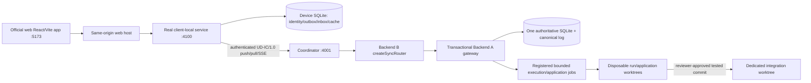

# Verified local launch guide

Date: 4 November 2026, Asia/Kolkata. This release derives from
`integration/final-mvp` at `775942e`, combines canonical A/B/frontend main, and
imports the owner-approved website fixes from `892e65d` / `05696bc` unchanged.
The original working directory, its local modifications, databases and branches
are preserved. No changes are pushed or merged into remote main by this task.

## Start from your home folder

The local machine has a new launcher at `C:\Users\diksh\Start-UpsideDown.ps1`:

```powershell
# Works from PS C:\Users\diksh>
.\Start-UpsideDown.ps1

# Gracefully stop only this managed launch
.\Start-UpsideDown.ps1 -Stop
```

It detects an already-running managed instance. The current local setup uses:

- Official frontend: **http://127.0.0.1:5175**
- Device-local service: **http://127.0.0.1:4110**
- Authenticated coordinator: **http://127.0.0.1:4001**
- Private persistent state: `%LOCALAPPDATA%\UpsideDown\final-mvp`

The original checkout later started another stack on 4000/4100/5173. The home
launcher uses 4001/4110/5175 to coexist; no unrelated port owner is terminated.
Unconfigured `npm run dev:all` still defaults to 4000/4100/5173.
The original error happened because `C:\Users\diksh` does not contain the repo's
`scripts` directory. A relative `\.\scripts\...` command must be run from the
correct repository; the new home launcher resolves the release path itself.

Release checkout:
`C:\Users\diksh\.codex\visualizations\2026\11\03\01a1a255-54fa-7a62-9af0-cafc26c1613a\final-mvp`

## Install and run from a release checkout

Requirements: Windows, Node 24.20+, npm 11.19+, Git for execution worktrees.
Dependencies and browser binaries must be installed before disconnecting internet.
The root lockfile contains registry packages and no machine-local dependency links.

```powershell
npm ci
npm --prefix web ci
npm --prefix web exec playwright install chromium
npm run dev:all
```

For the current complete local demo, including separately enrolled reviewer
credentials and a disposable Git repair fixture:

```powershell
npm run dev:all -- --coordinator-port 4001 --local-port 4110 --web-port 5175 --reviewer --demo-workspace --open
```

Omitting `--reviewer` keeps normal pairing unprivileged. `--demo-workspace`
registers only a marked fixture under private launch state, never your source
checkout. Execution/apply remain unavailable without a trusted workspace config.
`--open` launches the actual official UI and pairs the local browser without
printing or persisting credentials in browser storage. Chromium must be installed.
If launching without it, use the UI's Pair browser dialog and the pairingKey field
from the private `<state>\device.db.session.json` file. Do not use either bearer.

Other options:

```powershell
npm run dev:all -- --coordinator-port 4002 --local-port 4102 --web-port 5175 --state-dir C:\PrivateDemo\session-a
npm run stop:all -- --state-dir C:\PrivateDemo\session-a
```

Only a managed directory with a valid marker is reused. Nonempty unrelated state
folders are refused. Identity, DBs, token files and existing source are not reset.
One launcher owns a state directory at a time. Startup checks versions, dependencies,
writability, distinct/free ports, contract/authentication, real B pairing/health
and the actual built frontend. Failures stop only tracked child processes.

The full launcher serves the actual Vite-built official app through a same-origin
local proxy. This mode is a static development/demo host without Vite HMR; direct
`npm --prefix web run dev` remains available for frontend development.

## Stop, restart and logs

Foreground: Ctrl+C. Background: `npm run stop:all`, or the home script's `-Stop`.
A protected local named-pipe control channel requests graceful service shutdown;
it does not enumerate or kill unrelated processes. The launcher owns its child
PIDs, and uses a bounded forced fallback only for its own unresponsive children.
SQLite state survives restart. An unexpected child exit fails the launch and
stops its other owned services; it never prints a successful readiness result for
a failed service. Restart the same command after inspecting the private logs.

Private state contains `coordinator.log`, `local-service.log`, browser profile,
DB/WAL/SHM, credentials and the protected lifecycle record. Do not publish it.
Verification logs without credentials are in the checkout's ignored
`.board/evidence/` directory. Windows redirected-profile EXDEV during frontend
selection replacement is handled by a metadata-only copy fallback.

## Actual architecture



Pairing uses HttpOnly/SameSite local cookies and CSRF. Device sync and reviewer
credentials are separate. B verifies reviewer authority live with A; missing,
revoked, invalid or unreachable authority cannot grant review permissions.
Client headers/token text and body reviewerId values cannot create authority.
Body/command limits, device/sequence identity, durable idempotency, private-message
filtering and cursor replay remain canonical UD-IC/1.0 behavior.

## Demonstrate the complete verified code flow

See `HACKATHON_DEMO_GUIDE.md`. In the supplied disposable workspace:

- Workspace ID: `demo-source`
- Test profile ID: `demo-check`
- Application target: `demo-integration`

A real heuristic repairs `1 / 0` in the fixture, with actual local Node tests.
Approval leaves task in review and changes no source. Explicit apply retests and
commits only to the dedicated demo integration worktree before marking done.
The source fixture and your developer checkout remain unchanged. Passing this
fixture does not establish general model intelligence or hostile-code sandboxing.

The repair fixture is intentionally one application per base commit. For a fresh
rehearsal, stop the current managed instance and run `npm run demo:new`. This reset
mechanism creates a NEW marked demo state and retains every previous state; it
never deletes application records, source or checkpoints. The new state path is
printed. Stop that instance with `npm run stop:all -- --state-dir THE_PRINTED_PATH`.

## Frontend activation and safe rollback

The primary application is `web/`; `frontend/` remains an obsolete preserved
prototype. `apps/demo-frontend/` is preserved as a clearly marked read-only rollback
view with actual task/agent/activity reads; mutation controls are disabled.
The old project/handoff/settings tabs are unavailable through the canonical local
proxy. Use the official app for queued actions, conflicts and review.

```powershell
npm run frontend:status
npm run frontend:activate
npm run build:demo
npm run frontend:rollback
# Switch back after checking the fallback:
npm run frontend:activate
```

The default commands target the same default managed state as `dev:all`. For a
custom launch, pass `-- --state-dir YOUR_STATE` to each frontend command.
Activation performs the real TypeScript/Vite build, checks referenced assets, and
only then changes selection. The web host reads that state on each page load.
Tests verify actual HTTP responses change between official hashed Vite assets and
demo assets, then return to the official app without changing domain data.

## Tests and evidence

```powershell
npm run verify:release
npm --prefix web run test:e2e
node client-local/scripts/test-website.mjs
npm run test:browser-live
# One-shot, against an unapplied --demo-workspace instance:
npm run test:live-execution
```

The last two commands use the private managed state to discover actual URLs and
operate Chromium against the running stack. They create explicitly labeled demo
records; the execution test applies only the marked disposable Git fixture.
`test-website.mjs` uses temporary real A/B/Git services and checks reviewer
application/conflict/revocation; its one injected response is explicitly labeled
as a definitive message-rejection test. Fixture browser tests are reported
separately from actual-service checks.

Do not run the opt-in fixed-port browser local-service test while a different
instance occupies 4100/5173. Stop your managed app first. The existing legacy
unauthenticated backend browser smoke is deliberately not enabled for this
hardened launch. This is recorded as one skipped compatibility test.

## Limits and remaining ownership work

Physical Computer B is unavailable, so physical LAN/internet-off validation is
NOT TESTED. See `TWO_COMPUTER_SETUP.md` for executable onboarding. HTTP is limited
to a trusted private demo LAN, not a public production release. No firewall rule,
public deployment, remote merge/push or recurring coordination agent is created.

The human explicitly approved narrow project/handoff web/local-proxy integration
in this chat (board #6617052077). Projects and Handoffs pages now use the retained,
bounded A APIs through B's exact allowlist, with paired CSRF and stable idempotency.
Device-owned agent registration, assigned tasks, task/dependency/project-context
handoffs and recipient ACKs are exercised through two real browser/device sessions.
Forgery is rejected and duplicate ACKs return the original record. Project/handoff
writes are online-only; stale cached views disable actions, and successful native
sync revalidates them after reconnect. Canonical offline task/message Command types
are unchanged. Project context is recorded on a handoff; tasks remain global
workspace records rather than acquiring an undocumented projectId field.

Automatic watcher-triggered durable runs, independent AI-agent
execution, real LLM recovery and automatic coordinator failover are not claimed.

## The supplied LAN coordinator

The user selected `http://192.168.137.242:4001`. An unauthenticated request returned
401, proving reachability only. Existing local credentials were not sent: automatic
approval rejected that check, and the user chose fresh enrollment instead.

A separate local installation is initialized at
`C:\Users\diksh\AppData\Local\UpsideDown\lan-192-168-137-242`.
Device UUID: `e14609f1-282f-4795-b347-8f401797d976`.
Arhaan confirmed enrollment on that coordinator (board #6617259985), principal
`8f1fb55e-913e-4e0e-8233-228c071f3986`.

The newly issued bearer remains in the protected file on Arhaan's computer:
`E:\Upside\.board\website-runtime\dikshant-device.token`.
Transfer through USB/trusted direct file copy to this laptop's protected
`...\lan-192-168-137-242\device.token`; never paste into board/chat. Actual
authentication/delivery remains BLOCKED until that file is present.

Once it is copied, the LAN home wrapper uses local service 4111/UI5176 so it
can coexist with both the original checkout and the verified local demo.

Once it is copied and ports are free:

```powershell
# From the user's home folder:
.\Start-UpsideDown-LAN.ps1
```

This starts the local peer/UI pointed at the selected remote coordinator, with
its own device DB and sequence history. It never reuses the original local token.
The equivalent repo script is `scripts/start-peer.ps1 -CoordinatorUrl URL`; it
checks for the fresh token before starting services. Stop a local managed A stack
first if it still occupies 4100/5173; no script clears somebody else's ports.
